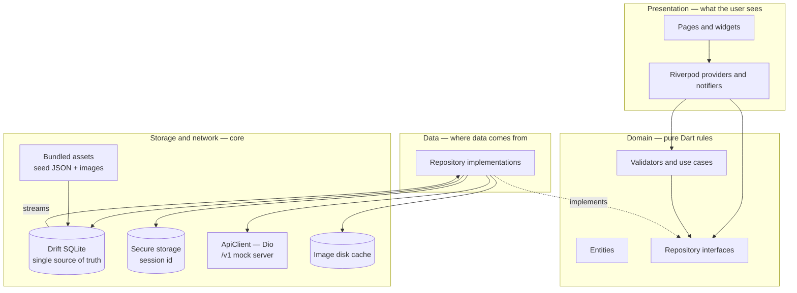
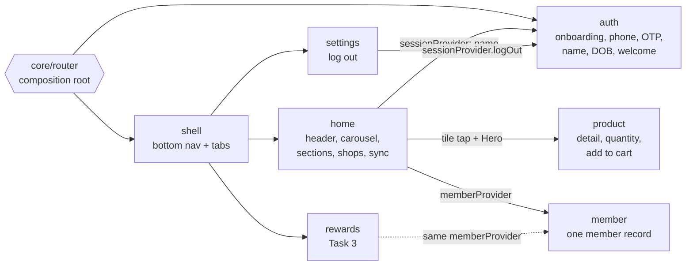
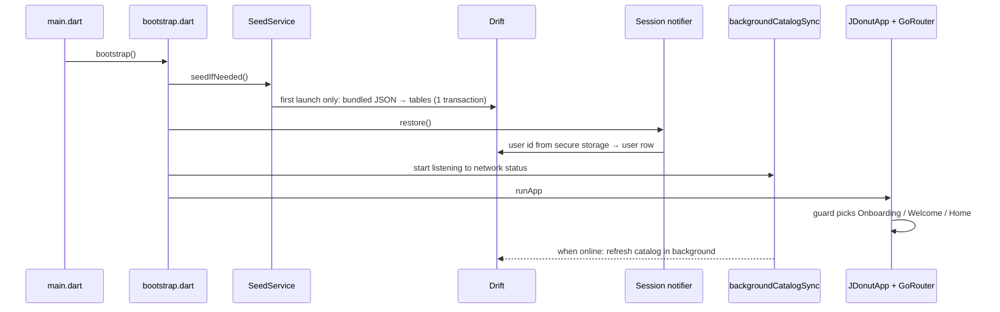
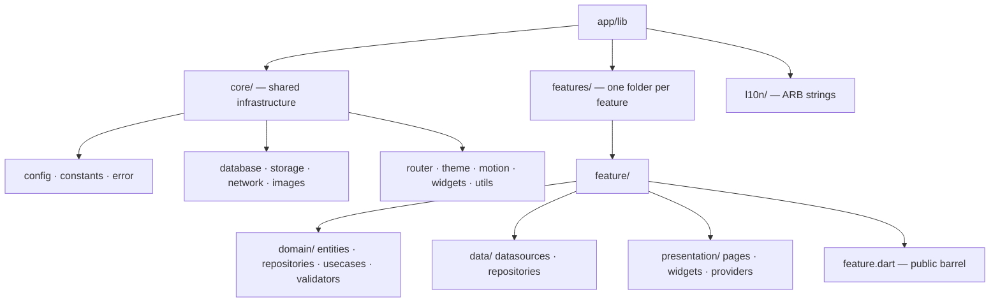

# Architecture Overview

Three layers per feature. Presentation and Data both depend on Domain;
Domain depends on nothing Flutter. The UI only ever reads the local database.

## The big picture

**Rule of thumb:** arrows never point *up* into Presentation, and nothing in
Domain imports Flutter, Dio, Drift or Riverpod.

## Features and how they talk

Features import each other **only through barrels** (`auth/auth.dart`,
`product/product.dart`, `member/member.dart`, …).

## App startup — before the first frame

## Where things live

