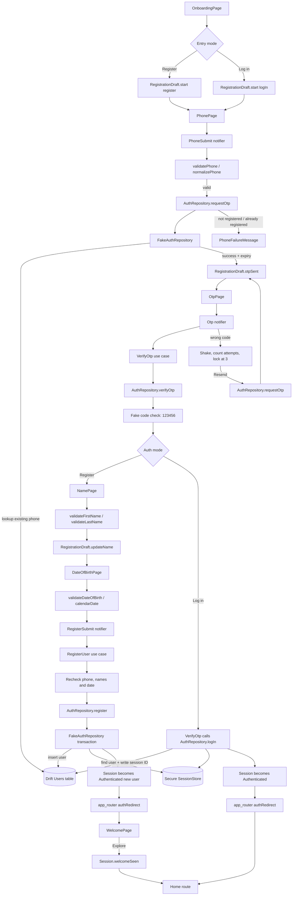
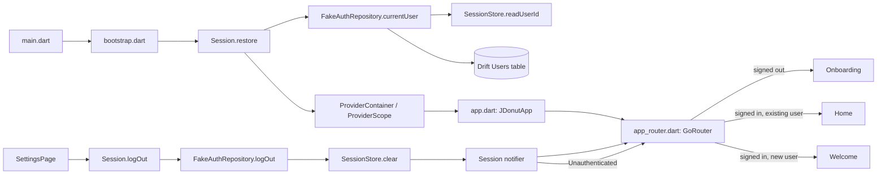
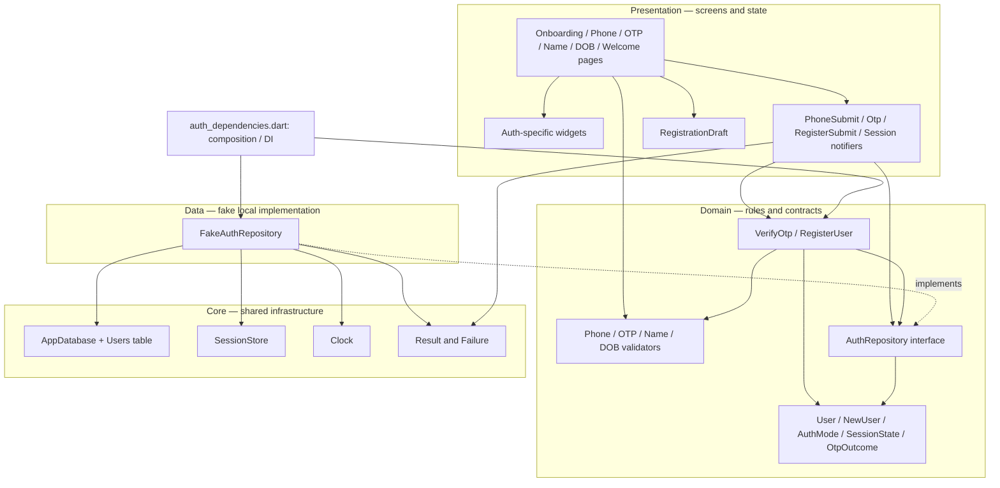

# Authentication — File Map

This guide follows the current code under `app/lib/` and `app/test/`. Task 1
uses a local fake-auth repository: there is no auth API or `mock_server`
dependency in this flow. Users are stored in Drift; the active session ID is
stored through secure storage.

## Registration and login flow

Both entry paths share the Phone and OTP screens. Registration continues
through Name, Date of Birth, and Welcome. Login signs an existing user in after
OTP verification and the router sends them to Home.



## Startup, route guard, and logout

The session is restored before Flutter paints the first frame. The router
observes session changes and redirects users away from routes they should not
visit.



## Layer and dependency map



## File responsibilities

### App startup and routing

| File | Responsibility |
|---|---|
| `app/lib/main.dart` | Entrypoint; delegates startup to `bootstrap()`. |
| `app/lib/bootstrap.dart` | Creates the Riverpod container, restores the session before the first frame, then runs the app in that container. |
| `app/lib/app.dart` | Builds `JDonutApp`, `MaterialApp.router`, app theme, router, and localization delegates. |
| `app/lib/core/router/app_routes.dart` | Central constants for route paths and the public-route check. |
| `app/lib/core/router/app_router.dart` | Declares auth and shell routes, listens to session state, and implements the pure `authRedirect` guard. |
| `app/lib/core/router/page_transitions.dart` | Shared route transition builders used by the router. |
| `app/lib/features/auth/auth.dart` | Auth feature barrel: exposes auth pages, session types, and `sessionProvider` to app-level routing and other features. |
| `app/lib/features/shell/shell.dart` | Barrel for the signed-in app shell and placeholder tabs. |
| `app/lib/features/shell/presentation/pages/app_shell.dart` | Five-tab signed-in navigation shell. |
| `app/lib/features/settings/settings.dart` | Settings feature barrel. |
| `app/lib/features/settings/presentation/pages/settings_page.dart` | Settings screen; its logout action clears the session and lets the router redirect. |

### Auth domain

| File | Responsibility |
|---|---|
| `app/lib/features/auth/domain/entities/auth_mode.dart` | Distinguishes registration from login. |
| `app/lib/features/auth/domain/entities/user.dart` | Immutable signed-in user model. |
| `app/lib/features/auth/domain/entities/new_user.dart` | Immutable validated registration input passed to the repository. |
| `app/lib/features/auth/domain/entities/otp_outcome.dart` | Represents the two successful OTP outcomes: signed-in user or continue registration. |
| `app/lib/features/auth/domain/entities/session_state.dart` | Session states: unknown, unauthenticated, or authenticated (including first-time user state). |
| `app/lib/features/auth/domain/repositories/auth_repository.dart` | Contract for OTP request/verification, login, registration, session restore, and logout. |
| `app/lib/features/auth/domain/usecases/verify_otp.dart` | Verifies OTP and either returns registration continuation or logs in the returning user. |
| `app/lib/features/auth/domain/usecases/register_user.dart` | Revalidates registration input, trims names, and calls the repository to register. |
| `app/lib/features/auth/domain/validators/phone_validator.dart` | Validates Myanmar phone format and normalizes it to E.164. |
| `app/lib/features/auth/domain/validators/otp_validator.dart` | Checks OTP length/digits and lock/attempt counts. |
| `app/lib/features/auth/domain/validators/name_validator.dart` | Validates required first name and optional last name, including Myanmar letters and disallowing digits. |
| `app/lib/features/auth/domain/validators/date_of_birth_validator.dart` | Builds real calendar dates and checks future dates and minimum age. |

### Auth data and Riverpod state

| File | Responsibility |
|---|---|
| `app/lib/features/auth/data/repositories/fake_auth_repository.dart` | Implements the auth contract with a fake delay, local OTP `123456`, Drift user records, secure session storage, and typed failures. Registration inserts the user and writes the session ID in one transaction. |
| `app/lib/features/auth/presentation/providers/auth_dependencies.dart` | Composition seam: creates the clock, concrete fake repository, and `VerifyOtp` / `RegisterUser` use cases. |
| `app/lib/features/auth/presentation/providers/registration_draft.dart` | Keeps entry mode and entered phone/name/date/OTP expiry across pages; reset when a new flow starts or the draft is cleared. |
| `app/lib/features/auth/presentation/providers/submit_state.dart` | Shared immutable loading/failure state for submit actions. |
| `app/lib/features/auth/presentation/providers/phone_submit_notifier.dart` | Guards duplicate taps, validates and normalizes phone input, requests OTP, stores its expiry, and reports phone registration conflicts. |
| `app/lib/features/auth/presentation/providers/otp_notifier.dart` | Tracks verifying/resending state, wrong attempts and lockout; verifies/resends codes and updates session for login. |
| `app/lib/features/auth/presentation/providers/register_notifier.dart` | Converts the date draft to a calendar date, calls `RegisterUser`, and marks a new session on success. |
| `app/lib/features/auth/presentation/providers/session_notifier.dart` | Restores, updates, marks welcome seen, and logs out the app-wide session. |
| `app/lib/features/auth/presentation/auth_progress.dart` | Calculates the progress ring value for each registration or login step. |

### Auth screens and widgets

| File | Responsibility |
|---|---|
| `app/lib/features/auth/presentation/pages/onboarding_page.dart` | Entry screen; starts register or login mode and routes to Phone. |
| `app/lib/features/auth/presentation/pages/phone_page.dart` | Phone input, focus-aware validation, request loading, and transition to OTP. |
| `app/lib/features/auth/presentation/pages/otp_page.dart` | OTP screen; verifies code, routes new users to Name, and displays resend/error state. |
| `app/lib/features/auth/presentation/pages/name_page.dart` | First/last-name input and validation; stores values in the draft. |
| `app/lib/features/auth/presentation/pages/date_of_birth_page.dart` | Month/day/year input, age/date validation, and final registration submit. |
| `app/lib/features/auth/presentation/pages/welcome_page.dart` | First-time welcome screen; clears the new-user routing state when the user explores. |
| `app/lib/features/auth/presentation/widgets/auth_background.dart` | Shared pink-to-white auth background. |
| `app/lib/features/auth/presentation/widgets/auth_step_scaffold.dart` | Shared back button, step title, progress ring, form area, action, and terms layout. |
| `app/lib/features/auth/presentation/widgets/onboarding_hero.dart` | Animated donut hero on onboarding. |
| `app/lib/features/auth/presentation/widgets/otp_input.dart` | Six visual OTP boxes backed by one field for typing, paste, backspace, and SMS autofill. |
| `app/lib/features/auth/presentation/widgets/resend_countdown.dart` | Countdown derived from the OTP expiry time; enables resend at zero. |
| `app/lib/features/auth/presentation/widgets/phone_failure_message.dart` | Inline not-registered/already-registered message with a mode-switch link. |
| `app/lib/features/auth/presentation/widgets/month_field.dart` | Localized month selector used by date of birth entry. |
| `app/lib/features/auth/presentation/widgets/touched_focus_node.dart` | Remembers when an input has lost focus so validation can appear at the right time. |
| `app/lib/features/auth/presentation/widgets/social_sign_in_row.dart` | Placeholder Google/Apple/Facebook actions; no social auth integration. |
| `app/lib/features/auth/presentation/widgets/terms_text.dart` | Terms and privacy links that open placeholder sheets. |

### Shared core used by Task 1

| File or folder | Responsibility |
|---|---|
| `app/lib/core/database/app_database.dart` | Drift database setup and schema/migration version. |
| `app/lib/core/database/tables/users_table.dart` | Local user table schema. |
| `app/lib/core/database/database_provider.dart` | App-wide Riverpod provider for the database and its lifecycle. |
| `app/lib/core/storage/session_store.dart` | Session storage interface and secure-storage implementation. |
| `app/lib/core/storage/storage_providers.dart` | App-wide `SessionStore` provider. |
| `app/lib/core/utils/clock.dart` | Injectable clock so age and OTP-expiry logic can be tested deterministically. |
| `app/lib/core/constants/app_constants.dart` | Shared OTP, resend, age, name-length, and fake-delay values. |
| `app/lib/core/error/result.dart` and `failure.dart` | Typed success/failure values returned across repository and use-case boundaries. |
| `app/lib/core/l10n/l10n.dart` and `app/lib/l10n/*.arb` | Localization access extension and English/Burmese source strings. `app/lib/l10n/gen/` is generated. |
| `app/lib/core/theme/` | Brand colors, typography, spacing, context extensions, and `AppTheme` used by the auth screens. |
| `app/lib/core/motion/` | Named durations, curves, stagger timings, and Reduce Motion helpers. |
| `app/lib/core/widgets/app_button.dart`, `app_text_field.dart` | Reusable button and input components used throughout auth. |
| `app/lib/core/widgets/progress_ring.dart`, `shake.dart` | Shared progress and rejection animations used by the auth flow. |
| `app/lib/core/widgets/donut_art.dart`, `staggered_entrance.dart`, `entrance_controller_mixin.dart` | Reusable donut artwork and entrance motion used on onboarding and welcome. |
| `app/lib/core/widgets/placeholder_sheet.dart` | Placeholder destination for non-integrated terms/social actions. |

### Tests

| Test file | Covers |
|---|---|
| `app/test/features/auth/domain/validators/phone_validator_test.dart` | Phone normalization and valid/invalid formats. |
| `app/test/features/auth/domain/validators/otp_validator_test.dart` | OTP completeness and attempt lock rules. |
| `app/test/features/auth/domain/validators/name_validator_test.dart` | Required/optional names, Myanmar letters, length, and digit rejection. |
| `app/test/features/auth/domain/validators/date_of_birth_validator_test.dart` | Calendar validity, leap years, future dates, and age boundary. |
| `app/test/features/auth/domain/usecases/verify_otp_test.dart` | OTP success/failure and login-versus-registration outcome. |
| `app/test/features/auth/domain/usecases/register_user_test.dart` | Registration revalidation and repository call behavior. |
| `app/test/features/auth/data/fake_auth_repository_test.dart` | Fake repository, in-memory database, and session behavior. |
| `app/test/features/auth/presentation/login_validation_test.dart` | Phone/login/OTP widget behavior. |
| `app/test/features/auth/presentation/registration_validation_test.dart` | Name and date-of-birth widget validation. |
| `app/test/core/router/auth_redirect_test.dart` | Public/protected route decisions for each session state. |
| `app/test/helpers/test_auth.dart`, `in_memory_session_store.dart` | In-memory dependencies for repository tests. |
| `app/test/helpers/pump_auth_page.dart` | Shared widget-test setup: localization, theme, provider overrides, and router. |

## Generated files

Files ending in `.g.dart` are generated by Riverpod/Drift; files ending in
`.freezed.dart` are generated by Freezed. They provide provider code, database
data classes, and immutable model/state implementations. Edit their matching
source file and rerun code generation instead of editing generated files
directly. Localization output under `app/lib/l10n/gen/` is generated from the
ARB files.

## Useful commands

From `jdonut_flutter/app/`:

```sh
dart run build_runner build --delete-conflicting-outputs
flutter gen-l10n
flutter analyze
flutter test
```
