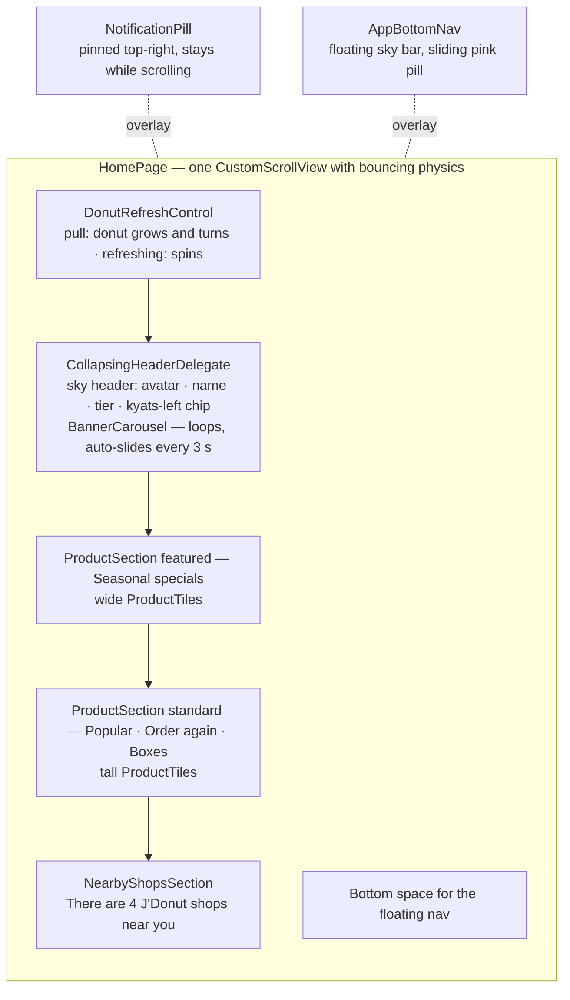
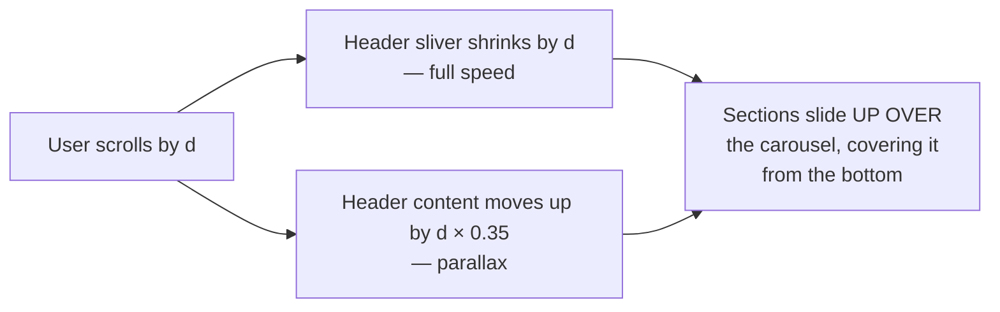
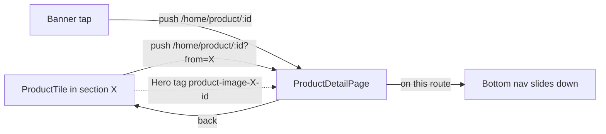
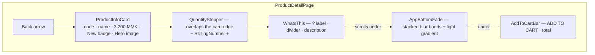
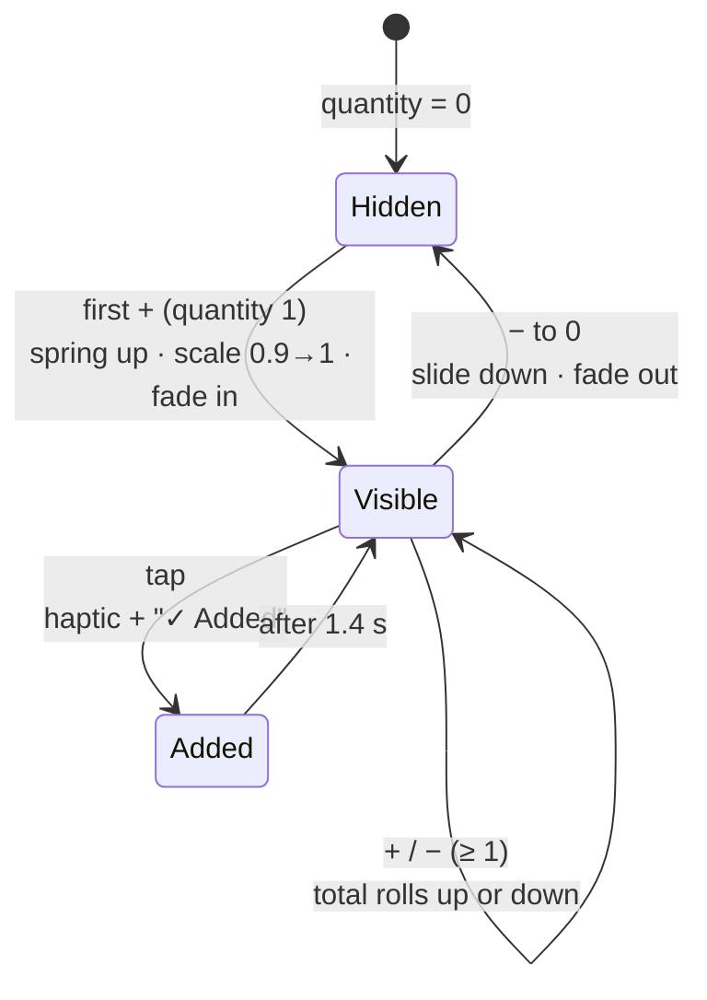

# Home and Product Detail — File Map (Task 2)

## Home screen anatomy

Each block has its own state: **skeleton** while loading, **inline error**,
**empty** message — one failing block never breaks the others.

## The overlap scroll effect

One scroll view (no `NestedScrollView`), so the carousel stays swipeable and
pull-to-refresh works.

## Navigation

Product detail is a **child of the Home tab** because a Hero only flies
between pages of the same Navigator. `from` keeps Hero tags unique when one
product appears in several sections.

## Product detail anatomy

## Add to cart — states

## File responsibilities

### Home

| File | Responsibility |
|---|---|
| `app/lib/features/home/presentation/pages/home_page.dart` | Page layout, pull-to-refresh, section stagger, pinned bell. |
| `app/lib/core/widgets/donut_refresh_control.dart` | Pull-to-refresh with the donut image (`CupertinoSliverRefreshControl` builder); opens below the status bar. |
| `.../widgets/collapsing_header_delegate.dart` | Shrinking header with parallax → the overlap effect. |
| `.../widgets/home_header.dart` | Avatar, name, tier, "kyats left" chip; computes its own height from text styles. |
| `.../widgets/banner_carousel.dart` | Peeking, looping carousel; auto-advance every `AppDurations.bannerAutoPlay`; drag restarts the timer. |
| `.../widgets/product_section.dart` | Section title + horizontal tiles, or an empty message. |
| `.../widgets/product_tile.dart` | White card, Hero image, New / % off badge from data; opens Product detail. |
| `.../widgets/section_header.dart` | Title + round arrow button. |
| `.../widgets/nearby_shops_section.dart` | Background image to the bottom of the screen (grass behind the nav), title, Explore now, shop cards with photo / name / address / Order Online — display only. |
| `.../widgets/notification_pill.dart` | Orange bell pill with the member's count. |
| `.../widgets/home_skeletons.dart` | Carousel/section skeletons and inline section error. |
| `.../widgets/tier_label.dart` | `MemberTier` → localized label. |
| `app/lib/features/shell/presentation/widgets/app_bottom_nav.dart` | Floating nav; active pill slides while slots resize. |
| `app/lib/features/shell/presentation/pages/app_shell.dart` | Five tabs; hides the nav on full-screen routes. |

### Product detail

| File | Responsibility |
|---|---|
| `app/lib/features/product/presentation/pages/product_detail_page.dart` | Loading / not found / content; stacks fade and Add to cart over the scroll. |
| `.../widgets/product_info_card.dart` | Card with code, name, price, New badge, Hero image; holds the stepper on its edge. |
| `.../widgets/quantity_stepper.dart` | −/+ with press feedback; number rolls with the change. |
| `.../widgets/whats_this.dart` | "What's this?" label and description. |
| `.../widgets/add_to_cart_bar.dart` | Spring-in bar, rolling total, "✓ Added" feedback. |
| `app/lib/features/product/domain/cart_quantity.dart` | Quantity rules (0…99) and line total. |
| `app/lib/features/product/presentation/providers/product_providers.dart` | Product stream + per-product quantity notifier. |
| `app/lib/features/product/presentation/product_hero.dart` | Hero tag builder. |
| `app/lib/core/widgets/app_bottom_fade.dart` | Progressive blur + fade (same technique as vint_flutter's feed). |
| `app/lib/core/widgets/rolling_number.dart` | Number that rolls up or down when it changes. |

### Tests

| Test file | Covers |
|---|---|
| `app/test/features/product/product_detail_test.dart` | Code/name/price formatting, first + reveals the bar with the live total, back to 0 hides it, quantity rules. |
