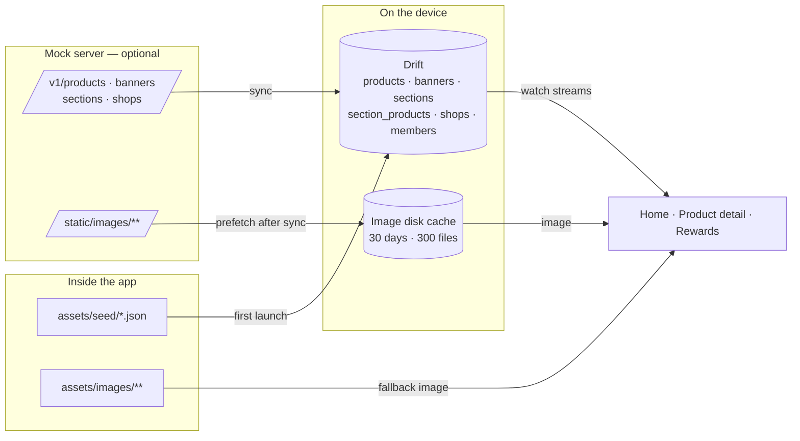
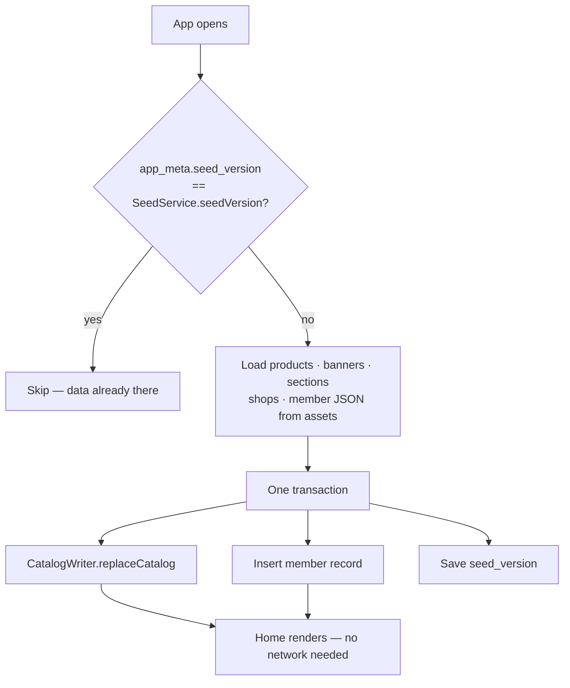
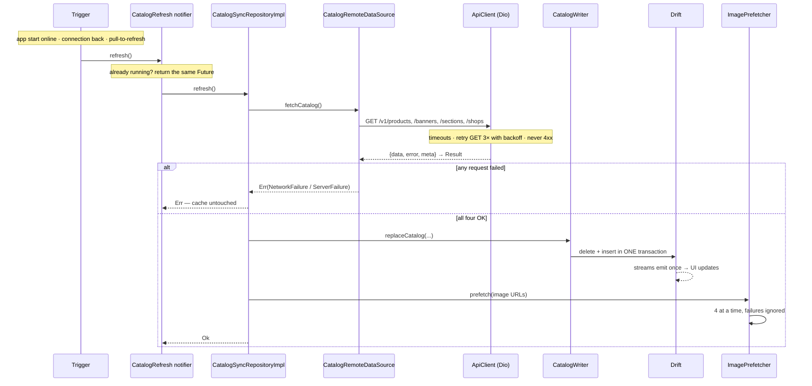
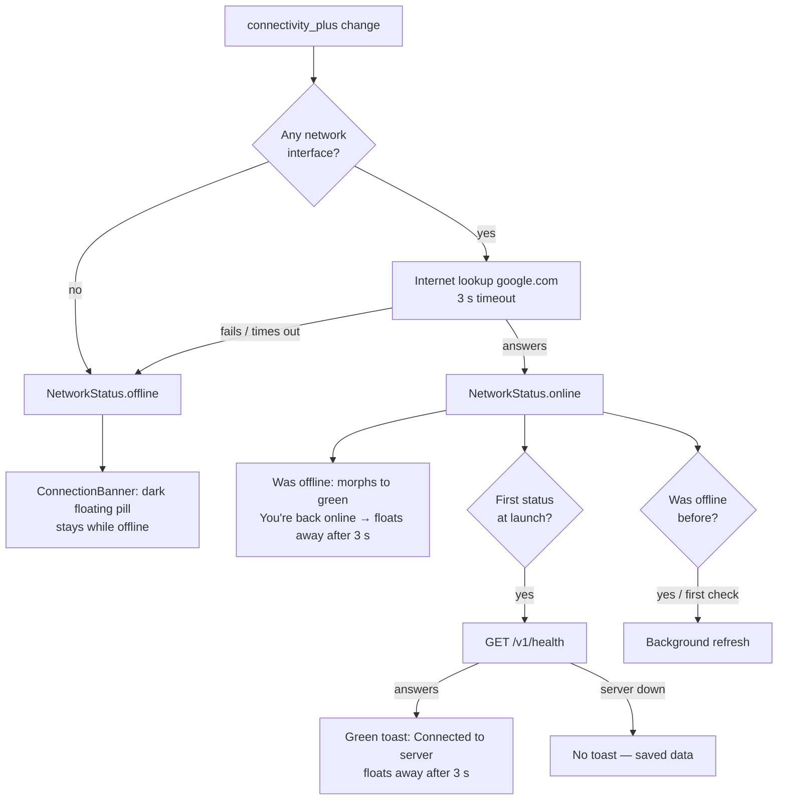
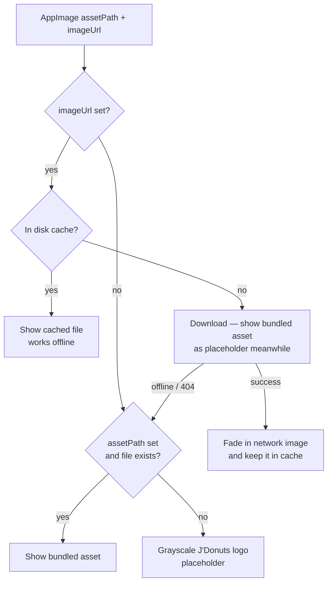
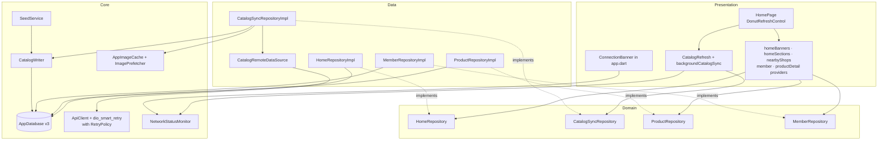

# Offline Data — File Map (Task 2)

The app works offline from the very first launch. The local Drift database is
the **single source of truth**: the UI only reads Drift streams, and the
network only writes into Drift. Images come from a disk cache, with bundled
assets as the fallback.

## Where data comes from



## First launch — seeding



## Sync — refreshing from the server



Malformed server data (wrong types, missing fields) is caught before or
during the transaction and rolled back — the old cache stays.

## Online or offline?



Why the lookup: connectivity alone says "online" on Wi-Fi with no internet.
This is **device** internet status — a stopped mock server is not "offline";
sync then just fails quietly and keeps the saved data.

## Which image is shown — AppImage



## Layer map



## File responsibilities

### Database and seeding

| File | Responsibility |
|---|---|
| `app/lib/core/database/app_database.dart` | Drift DB, schema **v3**. v1→v2 creates the catalog/member/meta tables; v2→v3 adds shop photo columns. |
| `app/lib/core/database/tables/catalog_tables.dart` | Products, Banners, Sections, SectionProducts (ordered links), Shops. |
| `app/lib/core/database/tables/member_tables.dart` | Members (one record) and AppMeta (key/value, e.g. seed version). |
| `app/lib/core/database/seed/seed_mappers.dart` | JSON → Drift rows. Seed files and `/v1` share one shape. Throws `FormatException` on bad data. |
| `app/lib/core/database/catalog_writer.dart` | Replaces the whole catalog in one transaction. Used by seeding **and** sync. |
| `app/lib/core/database/seed/seed_service.dart` | First-launch seeding from `assets/seed/*.json`, guarded by `seed_version`. |
| `app/lib/core/database/database_provider.dart` | `appDatabaseProvider`, `seedServiceProvider`. |

### Network

| File | Responsibility |
|---|---|
| `app/lib/core/config/env.dart` | Server address: `10.0.2.2` on Android emulator, `localhost` on iOS, or `--dart-define=API_BASE_URL`. |
| `app/lib/core/network/api_paths.dart` | `/v1` endpoint paths; turns relative image paths into full URLs. |
| `app/lib/core/network/network_constants.dart` | Timeouts, retry count, backoff base. |
| `app/lib/core/network/api_envelope.dart` | Unwraps `{data, error, meta}` into `Result`. |
| `app/lib/core/network/retry_policy.dart` | Our rules for `dio_smart_retry`'s `RetryInterceptor`: GET only, max 3, never 4xx; delays 400 ms → 1.6 s with jitter. |
| `app/lib/core/network/api_client.dart` | The only HTTP client. Maps every `DioException` to a typed `Failure`. |
| `app/lib/core/network/network_status.dart` | Device internet: a network interface **and** a real lookup within 3 s. Independent of the mock server. |
| `app/lib/core/network/network_providers.dart` | `apiClientProvider`, `networkStatusProvider`. |

### Images

| File | Responsibility |
|---|---|
| `app/lib/core/images/app_image_cache.dart` | Disk cache config (30 days, 300 files). URL is the cache key. |
| `app/lib/core/images/image_prefetcher.dart` | Downloads images after a sync, 4 at a time; failures fall back to assets. |
| `app/lib/core/widgets/app_image.dart` | The one image widget: cache → network → asset → grayscale logo. |

### Feature data and state

| File | Responsibility |
|---|---|
| `app/lib/features/home/data/datasources/catalog_remote_data_source.dart` | Fetches the four `/v1` lists; all must succeed. |
| `app/lib/features/home/data/repositories/catalog_sync_repository_impl.dart` | Remote → `CatalogWriter` → image prefetch; keeps cache on any error. |
| `app/lib/features/home/data/repositories/home_repository_impl.dart` | Watches banners, sections (joined with products, in order) and shops. |
| `app/lib/features/home/presentation/providers/catalog_refresh.dart` | Single-flight refresh + background sync on start / reconnect. |
| `app/lib/features/home/presentation/providers/home_providers.dart` | Stream providers for Home's three data blocks. |
| `app/lib/features/product/data/repositories/product_repository_impl.dart` | Watches one product by id. |
| `app/lib/features/member/data/repositories/member_repository_impl.dart` | Watches the single member record (Home + Rewards). |
| `app/lib/core/widgets/connection_banner.dart` | Toast-like floating pill: green "Connected to server" at launch (only if `/v1/health` answers), dark while offline, green "back online"; green toasts float away after 3 s. |

### Tests

| Test file | Covers |
|---|---|
| `app/test/core/database/seed_service_test.dart` | Seeds once, no duplicates, sections ordered with products. |
| `app/test/core/database/migration_test.dart` | v2 → v3 adds shop photo columns and keeps existing shops. |
| `app/test/features/home/catalog_sync_test.dart` | Replace + delete, image prefetch, offline keeps cache, malformed keeps cache. |
| `app/test/core/network/api_envelope_test.dart` | Envelope success, error code, malformed. |
| `app/test/core/network/retry_policy_test.dart` | When to retry and delay growth. |
| `app/test/core/network/network_status_test.dart` | No interface, Wi-Fi with internet, Wi-Fi without internet. |
| `app/test/core/widgets/connection_banner_test.dart` | Launch toast when the server answers, none when it's down; stays while offline; green then hidden on reconnect. |

## Try it

```sh
# 1. Server off → seeded data + bundled images, offline banner shows
cd app && flutter run
# 2. Server on → banner hides, background sync, images cached
cd mock_server && npm start
# 3. Airplane mode → relaunch → everything still renders
```
