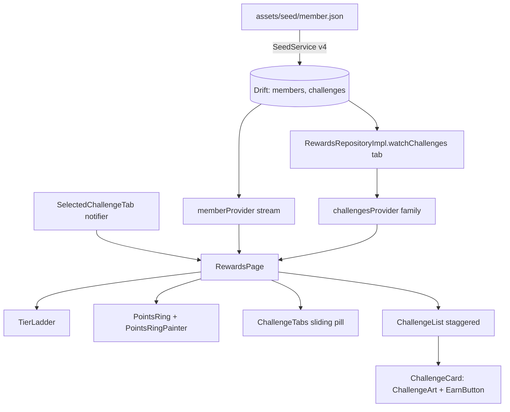

# Rewards (Task 3)

Entrance: one controller (`AppDurations.rewardsEntrance`) drives every slot in `AppStagger` (ladder, line, ring, badge, tabs). Replays when the tab turns visible (`TickerMode`).
